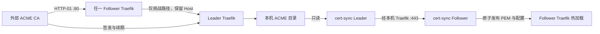

# cert-sync

独立的证书同步服务，服务／命令名 `cert-sync`，新镜像包
`ghcr.io/joysun99/neptu-cert-sync`。一个镜像按配置运行 Leader 或 Follower；
角色独立于 Device Dispatch，无自动选主。本目录是新实现，旧线上
`neptu-global-dispatch-certificate-mirror` 的包名、摘要和运行方式保留历史身份。

首期已[发布](../releases/cert-sync-53f9387.json)，提供 CLI Console、Web Console、
HTTPS Token Join／同步和 Traefik 适配。各部署的现场证据由部署仓库维护；Caddy 适配
仍待实现和验证，不将本镜像发布等同于所有代理或自然续期的生产验收。

## 运行托管与连接重试

Docker中使用前台 `cert-sync run --config /etc/neptu/cert-sync.json`，主进程为PID 1，
日志输出到stdout／stderr；Docker负责启动／停止／重启，正式Compose为 `unless-stopped`。
systemd原生部署也以前台运行（`Type=simple`），由systemd监督，不再套应用daemon；
本服务没有新增daemon子命令。手动 `docker stop` 后保持停止，恢复使用明确 `docker start`。

已Join的Follower在启动及运行中连不上Leader时，默认最多6次尝试，失败后等待
1、2、4、8、16秒，单次间隔上限30秒。成功后恢复正常同步间隔并重置本轮计数；耗尽后
非零退出，由Docker／systemd重新拉起。配置项为 `retryAttempts`（1..20，默认6）、
`retryInitialSeconds`（默认1）和既有 `retrySeconds`（默认30，现为退避上限）。
单次HTTPS请求仍保持原30秒截止，不延长原Join／凭据／证书有效期。

认证／授权、TLS身份、证书内容及本地状态错误直接失败，不能靠重试获得资格。SIGTERM／
SIGINT中断等待及在途拉取并正常退出。新Follower尚未Join时保持Console可用等待加入，
不生成身份或假定已同步；pending Join始终保留原请求／operationId，不能分配新请求重入网。
失败、重试和进程重启期间保留原凭据、最后验证的证书及Traefik配置，只有完整验证成功
才原子更新。旧证书到期后不得当作有效续期；Traefik仍按证书实际有效性服务。

上述有限退避为当前工作区新实现，23项单元／协议及18项实际Docker／Traefik本地检查通过；
尚未发布的新代码不能标记为HKG／USG已启用，现在线上仍使用原53f9387发行。下方安装
示例的已发布32d328摘要仍属于该旧发行，不接受新增retryAttempts／retryInitialSeconds字段；
使用新增配置前，须先部署后续验证发布的新digest，不能将新配置写给旧镜像。

## 工作方式



- 每个共享域名由指定 Leader 的 Traefik 申请和续期，单域名单证书。
- 所有指向该域名的入口，都要能把 `/.well-known/acme-challenge/` 送到签发节点；
  只部署同步服务不足以解决 HTTP-01 多 IP 验证。
- 每个节点使用**独享且只指向本节点**的 HTTPS 管理／同步域名，如
  `cert-hkg.example.net`、`cert-usg.example.net`。这些域名由本地 Traefik 单独申请，
  不加入共享证书列表。共享私钥的持有者不能借此冒充同步 API。
- Follower 持一次性、有限期、绑定 nodeId／域名的 Join Token 加入，随后使用自己的
  长期凭据。长期秘密在 Follower 本地产生，加入请求仅提交其摘要；Leader 不保存原文。
- 证书和私钥经验证的 HTTPS 443 传输，不依赖 SSH。服务内部监听 8080，不发布主机端口。
  80 只传 HTTP-01 挑战；Console 与同步 API 通过 Traefik 443 暴露。
- Leader 读取 ACME 文件，不导出账户私钥，只返回当前管理且已授权的域名单证书。
  Follower 验证证书签名链、系统信任、准确 DNS SAN、密钥匹配和有效期，然后原子发布。

[Let's Encrypt HTTP-01](https://letsencrypt.org/docs/challenge-types/#http-01-challenge)
要求从公网 80 端口取得挑战，可能从多个位置验证；多入口需要挑战路径一致可达。

## 每个节点部署什么

| 节点角色 | 证书服务 | Traefik 职责 | 不需要 |
| --- | --- | --- | --- |
| 签发节点，如 HKG | cert-sync Leader | 共享域名与本节点独享域名的 HTTP-01；反代 API | SSH 导出命令 |
| 消费节点，如 USG | cert-sync Follower | 共享挑战转发、加载同步证书；独享域名的本地 HTTP-01 | SSH 授权、共享 ACME 账户 |
| 无共享证书需求的节点 | 可不部署 | 继续本地申请 | 强制加入证书集群 |

一个 profile 至多 16 个共享 DNS 名称。一个 Follower 可消费授权列表的子集；域名列表
无主次。每个 profile 只有一个固定签发 Leader；不会因为 Device 角色改变而自动迁移。
不同域名需要不同签发节点时，使用不同 profile、独立状态目录和独立实例，不能由两个
实例同时管理同一证书。每个实例需独立 backendURL／端口或容器与管理 hostname。

## 配置与文件权限

使用 [leader.json](examples/leader.json) 或 [follower.json](examples/follower.json)。
修改示例 DNS 后保存为 `cert-sync.json`。示例不是线上配置。

| 字段 | 默认／要求 |
| --- | --- |
| `schemaVersion`, `role`, `nodeId` | `1`；`leader` 或 `follower`；稳定、小写节点名 |
| `profile` | `shared`；加入双方一致 |
| `publicURL` | 必填，节点独享的 HTTPS origin，无路径／凭据 |
| `domains` | 初次 init 的域名；之后 Console／CLI 保存到持久化 settings，修改原配置不会覆盖 |
| `stateDirectory` | `/var/lib/cert-sync`，持久化私有目录 |
| `targetDirectory` | `/etc/traefik/dynamic`；服务和 Traefik 内路径必须相同 |
| `acmeFile` | Leader `/run/acme/acme.json`，只读挂载其父目录 |
| `adminTokenFile` | `/run/secrets/admin-token`，本节点独立的 32 随机字节 base64url，无填充 |
| `listen`, `port` | `0.0.0.0:8080`，仅受控容器网络可访问 |
| `intervalSeconds` | 成功后的同步间隔，默认3600秒；单次HTTPS最多30秒 |
| `retryAttempts`, `retryInitialSeconds`, `retrySeconds` | 最多6次、初始1秒、退避上限30秒；连续失败耗尽退出 |
| `minimumValiditySeconds` | 接受新证书至少剩余 86400 秒 |
| `healthMaxAgeSeconds` | 最后成功校验至多 86400 秒，且不得低于两倍同步间隔 |
| `healthMinimumRemainingSeconds` | 少于 604800 秒报告不健康 |
| `proxy` | `type: traefik`，resolver／entryPoint 名称与现有 Traefik 一致 |
| `proxy.tlsOptions` | 可选，沿用同一 hostname 已有的命名 TLS 策略，如 `clean-global-node`；不填则使用 Traefik 默认策略 |
| `sourceCAFile` | 可选私有 CA 文件，仅用于同步 HTTPS 的 TLS 信任；通常省略使用系统信任 |
| `connectAddress` | 可选固定源 IP，TLS 仍校验 sourceURL hostname；通常省略使用 DNS |

目录 0700，配置、管理 Token、加入邀请、状态与证书／密钥 0600，所有者为容器运行
UID。示例统一 UID/GID 1000。拒绝符号链接、硬链接和不安全文件权限；不要把私有文件
放入 Git、镜像构建上下文或日志。状态目录、动态证书目录与 ACME 目录分开管理。

## 与 Traefik 配合

合并 [静态配置片段](examples/traefik-static.yml)，保留原 provider、业务规则和 TCP
SNI／ALPN 路由。只有 HTTP Host／路径增加 cert-sync 路由，不修改 Device TCP 协议。
如原 Traefik 使用内部 8080／8443 映射公网 80／443，保留原地址；入口名称按配置匹配。

- 同一 hostname 的现有 HTTP TLS router 若配置了命名 TLS options，必须在 `proxy.tlsOptions`
  显式填写同一名称。不能把 cert-sync 默认 TLS 策略与同 SNI 的现有命名策略混用。
- Leader 的 resolver 使用 HTTP-01，存储在独立的 ACME 目录；该目录给 Traefik 读写，
  给 cert-sync 只读。**挂载父目录，不能只绑定 acme.json 文件**，否则原子换文件后
  长期进程可能一直读取旧 inode。不要为方便而挂载整个包含其他秘密的生产 secrets 目录。
- Follower 的 `web.allowACMEByPass: true` 允许共享域名的用户路由优先处理挑战，
  独享 hostname 的挑战仍由本地 ACME 处理。
  [Traefik 说明](https://doc.traefik.io/traefik/v3.7/reference/install-configuration/entrypoints/#allowacmebypass)
  同时明确此设置会使全局 HTTP→HTTPS 跳转排除挑战路径。
- Follower 的共享业务域名 router 使用 `tls: {}`，**不设置 certResolver**。
  不要在 entryPoint 上设置会覆盖这些路由的全局 resolver；仅独享 hostname 使用本地 resolver。
- Leader 为每个管理域名单独生成请求 router，`tls.domains` 仅一个 `main`，不生成通配符
  或合并 SAN 证书。现有业务 router 不应再触发另一套重复／组合申请。
- 自动生成的 `cert-sync-<profile>-routes.yml` 仅归本服务管理；不要手工编辑。
  Follower 的 `<profile>-certificates.yml` 引用不可变 PEM 目录，由 file provider 热加载。
  不覆盖其他动态文件。不要让其他实例或旧 mirror 写同一个目标文档。
- Follower 挑战转发目标为邀请中 Leader 的独享 hostname 的 HTTP 80，保留原业务 Host；
  不转发至共享域名，以免再次落到 Follower 形成循环。

证书服务的 API／Console 路由从已有 443 进入内部服务，无需开放新的公网端口。
如果已有 TCP `HostSNI(*)` 无条件接管全部 TLS，须先按实际协议调整为明确 ALPN／SNI
选择器；不能直接覆盖原规则。现有节点改静态配置或目录挂载属于独立部署步骤。

## 公共镜像拉取

Leader、Follower及HKG／USG采用同一方式：在各节点的 `neptu-images` 仓库根目录，
使用临时空白客户端配置，直接匿名拉取准确GHCR digest：

```bash
python3 deploy/pull-public-image.py \
  ghcr.io/joysun99/neptu-cert-sync@sha256:32d328311f17c9de8b36d7d291d71422d15995c19dc03ccc649922c79cb2b1e3
```

工具不修改原登录凭据，不启动／重建服务；摘要和平台核对通过后，才使用下文同一
`CERT_SYNC_IMAGE` 配置部署。示例Compose采用 `pull_policy: never`，避免后续启服
重新使用旧登录信息隐式拉取。拉取失败先处理公共包访问，不切换镜像标签或默认改为
SCP中继。完整策略见[公共镜像指南](../README.md#public-ghcr-pull-policy)。

## 安装与加入

以下在新部署目录操作，假定当前用户和容器均 UID 1000；其他 UID 先显式调整所有权。
采用已验证的发布 digest，并先固定各节点的部署范围与回退条件。

```bash
export CERT_SYNC_IMAGE='ghcr.io/joysun99/neptu-cert-sync@sha256:32d328311f17c9de8b36d7d291d71422d15995c19dc03ccc649922c79cb2b1e3'
export TRAEFIK_NETWORK='<existing-ingress-network>'
install -d -m 700 state dynamic
node -e 'require("node:fs").writeFileSync("admin-token",require("node:crypto").randomBytes(32).toString("base64url")+"\n",{mode:0o600,flag:"wx"})'
chmod 600 cert-sync.json
```

使用 [compose.yml](examples/compose.yml)；Leader 另合并
[compose.leader.yml](examples/compose.leader.yml)。Traefik 另行挂载本目录的 `dynamic`
到同一个容器绝对路径 `/etc/traefik/dynamic`。Leader 的 ACME 目录挂载到 Traefik
`/var/lib/traefik/acme`；如为新安装，先创建 owner1000／0700 的 `acme`，不要覆盖已有 ACME。

```bash
# Leader；初始化只执行一次，重复 init 检查现有身份，不重新签发身份。
docker compose -f compose.yml -f compose.leader.yml run --rm cert-sync init
docker compose -f compose.yml -f compose.leader.yml up -d cert-sync
# 在 Leader 上创建绑定 USG 与所需域名的一次性邀请，不将 Token 打印到终端。
docker compose -f compose.yml -f compose.leader.yml run --rm cert-sync create-join-token \
  --node usg --domains dispatch.example.net,america.dispatch.example.net --ttl 3600 \
  --output /var/lib/cert-sync/usg-invitation.json
```

通过可信渠道把邀请 JSON 交给 USG；可在 Web Console 中生成和粘贴，不要求节点之间
能够 SSH。邀请是秘密。Follower 先 init，再运行服务，通过其独享 hostname 的 Console
加入；也可把 0600 邀请放入 USG 的 `state/usg-invitation.json` 后执行：

```bash
# Follower
docker compose run --rm cert-sync init
docker compose up -d cert-sync
docker compose run --rm cert-sync join --invitation /var/lib/cert-sync/usg-invitation.json
docker compose run --rm cert-sync sync
docker compose run --rm cert-sync status
```

加入仅注册，不保证证书已签发／同步，须检查 sync／status。实际失败时重试**同一邀请**：
Follower 已先保存原 operationId 和凭据；Leader 对同一请求返回原回执，已提交请求的
恢复不因 Token 后来过期而重复建节点。未提交的过期 Token 拒绝加入。已加入后本地
不再保留 Token 原文；外部邀请文件可在确认加入后安全移除。nodeId 不能静默覆盖旧成员，
重装应保留原 state 卷；全新身份需使用新 nodeId，旧成员显式撤销。

先打通两个独享 hostname、API 与挑战转发，再为**新**共享域名增加多 IP DNS 记录。
迁移已上线域名需保留当前证书、签发源和旧服务到新链路验证完成后再停旧服务。

## Console 与日常配置

- CLI：`docker compose exec cert-sync cert-sync console --config /etc/neptu/cert-sync.json`。
  Leader 的 exec 示例也在同一实例内执行；使用 Compose run 时记得 Leader override。
- Web：`https://<本节点独享hostname>/console`，输入本节点管理 Token。
  Token 只留当前页面内存，不写 cookie／localStorage；退出清除邀请显示。
- Leader 配置“需要申请和续期的域名”，再给每个 Follower 授权可取得的域名。
- Follower 配置“需要消费的域名”，只能取得其授权与 Leader 当前管理列表的交集；
  列表中任何未授权／缺失证书会使该次整批同步失败，保留旧证书。
- 增加已多 IP 的共享域名：先在已加入的 Follower 准备消费列表／挑战转发，再在 Leader
  增加申请列表和该 Follower 授权，证书 ready 后同步。不需重新 Join；准备期间暂时未
  授权／未签发会使整批同步保留旧证书。域名的业务 router／DNS 仍由部署配置管理。CLI 设置域名：`cert-sync domains --config ... --set a.example.net,b.example.net`。
- 删除域名：先停止对应业务使用，再删除消费列表／授权／Leader 列表；下一次成功同步
  移除本服务的活动证书引用，旧 PEM 版本保留。删除 Leader 列表不会自动清理 ACME 的
  历史证书；Traefik 可能仍续期存储中的历史条目，需要另行审阅后清理，不能宣称立即停止续期。
- 撤销：Web Console 或 `cert-sync revoke --config ... --node usg`。只阻止后续下载；
  无法收回已交付私钥。若节点泄露，应在 CA 撤销旧证书并生成新私钥重新签发。

Console 不提供 CA 账户导出、任意命令执行、SSH 配置或自动改 Device 角色。

## 失败处理与限制

同步失败不会删除当前有效证书；临时连接失败按上述有限指数退避重试，耗尽退出交给外部管理器。健康状态按成功校验新鲜度
和剩余有效期告警。Docker healthcheck 不等于证书可从公网访问，需监测实际握手。
Leader 不可用时 Follower 继续使用已有证书，但无法获得新证书；不自动切换签发源。

状态保存已交付证书的到期下界，拒绝旧证书回退；活动 PEM 也参与检查。域名删除后
再加入仍保留下界。Leader registry 保留最多 256 成员、1024 邀请／加入回执；Follower
保留最多 256 个历史域名下界。达到上限拒绝新增，不自动清理安全证据。

状态／registry／本地 client 卷必须持久化并限制访问；缺失时拒绝普通 run，不自动重建。
文件写入采用独占 writer 锁、不可变代次文件和原子配置切换。进程异常可能留下锁目录，
普通重试不会猜测旧 writer 已死。确认所有本 profile 写入进程停止后，审阅锁中 owner 和
现有文件，再处理残留锁并复验 status；不要并行启动两个修复过程。文件与目录持久性
取决于宿主机文件系统；本地合成测试不证明掉电恢复或灾难恢复能力。

当前版本无自然周期公网 CA 续期、长期容量或 Caddy 生产验收；发布及部署需独立验证。
当前 API 仅面向受控运维网络／Traefik，部署应保护管理 Token，并限制管理路径来源／速率。

## 未来支持 Caddy 等代理

同步协议、Join、授权和 PEM 不依赖 Traefik；目前证书读取源是 Traefik ACME JSON，
自动路由和热加载实现也是 Traefik 适配。`proxy.type: files` 可关闭自动 HTTP 路由生成，
仍输出 PEM 与证书路径文档，**不是已完成的 Caddy 适配器**。

Caddy 可以通过 [`tls <cert_file> <key_file>`](https://caddyserver.com/docs/caddyfile/directives/tls)
消费同步 PEM；还需实现相应配置生成、挑战转发与受限 reload。不能假定改 PEM 后会
自动重新读取。官方 [POST /load](https://caddyserver.com/docs/api#post-load) 可重新加载配置，
但管理 API 应仅在本地受限网络／Unix socket 使用；不能为同步暴露裸管理端口。
若由 Caddy 签发，还需实现 Caddy 证书存储读取适配，不能拿 Traefik acme.json 解析器代替。
后续沿相同 HTTPS 同步协议增加适配，无需依赖 SSH 或改为 Device 的一部分。

## 构建、验证与发布

```bash
# 在 neptu-images 仓库根目录执行
docker buildx bake -f cert-sync/docker-bake.hcl --load cert-sync cert-sync-test
docker run --rm --read-only --cap-drop ALL --security-opt no-new-privileges \
  --tmpfs /tmp:rw,noexec,nosuid,size=64m,mode=1777 neptu-cert-sync-test:local
python3 cert-sync/smoke-test.py
```

单元／协议测试使用合成 CA 和回环 HTTPS；集成检查在隔离 Docker 网络里用实际 runtime
镜像和真实 Traefik 验证 HTTP-01 路径、TLS 握手、ACME 换 inode、证书热加载和撤销保留。
没有访问真实 CA／生产节点。Python 3、OpenSSL、Docker 和非 root fixture owner 为前提。

独立 workflow 仅处理 cert-sync 家族；PR／main 默认只构建测试，手动选择 publish 后才
发布 `git-<full-sha>`，拉回准确 digest 复验实际镜像。生产只用验证的 digest。
新 GHCR 包应设为 Public 以支持匿名拉取。旧私有 mirror 的基础层含应用代码，不改为
Public，也不复用旧包作为新公共镜像。原始参考与新实现边界见 [provenance](provenance.json)。

2026-11-18 部署预检补充：新增 `proxy.tlsOptions` 保留现有命名 TLS 策略。初次
[17 项验证记录](verification.json)对应原始提交 `8417f0a`，其摘要保留历史字节；
修订候选另有 [TLS 策略验证](verification-tls-options.json)，不改写旧结果。

历史验证 JSON 的摘要分别绑定 `8417f0a`／`53f9387` 当时的源字节；后续指南更新
不改写这些历史记录。运行交付引用见[准确发行回执](../releases/cert-sync-53f9387.json)。

## Runtime writer contention

Foreground startup and background synchronization use the configured finite
retry policy when another writer temporarily holds an admission lock. Only
lock-directory acquisition is retried, before owner creation or any write
callback. An admitted callback is never repeated; existing locks are never
removed or stolen. Exhaustion exits for Docker supervision. Interactive CLI
commands retain their explicit lock refusal. TLS, authorization, state and
unknown write failures retain their original refusal behavior.

## Confirmed implementation follow-up

After the current verified Node rollout, cert-sync will be replaced with Go.
That application's source will live in a private repository; this public image
repository will retain the recipe, reviewed binary input, licenses, verification
and publication evidence. The Go replacement has not been implemented. It must
retain existing configuration, identity, active membership and Traefik behavior.
The current Node implementation is already public, including JavaScript files
inside its public image; this follow-up does not conceal or revoke that history.
